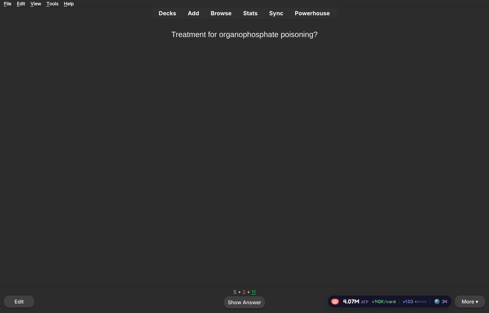
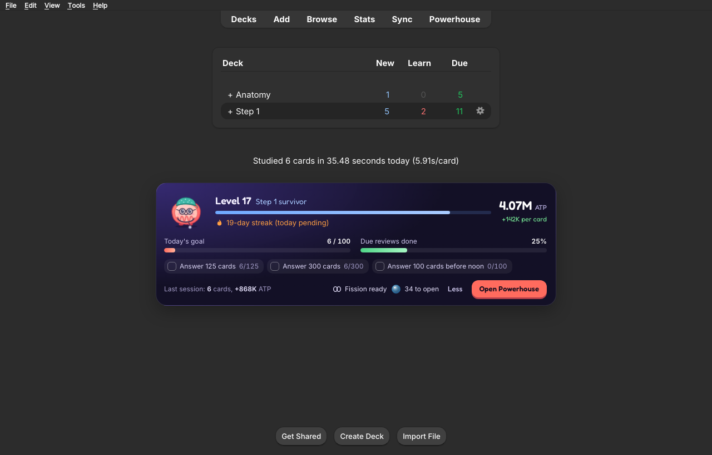
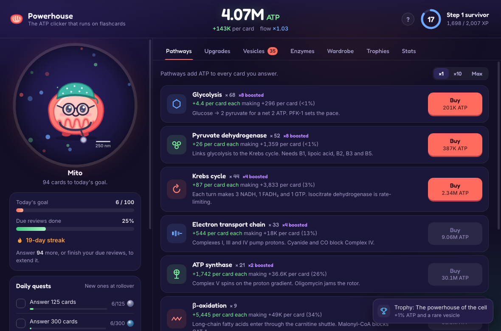
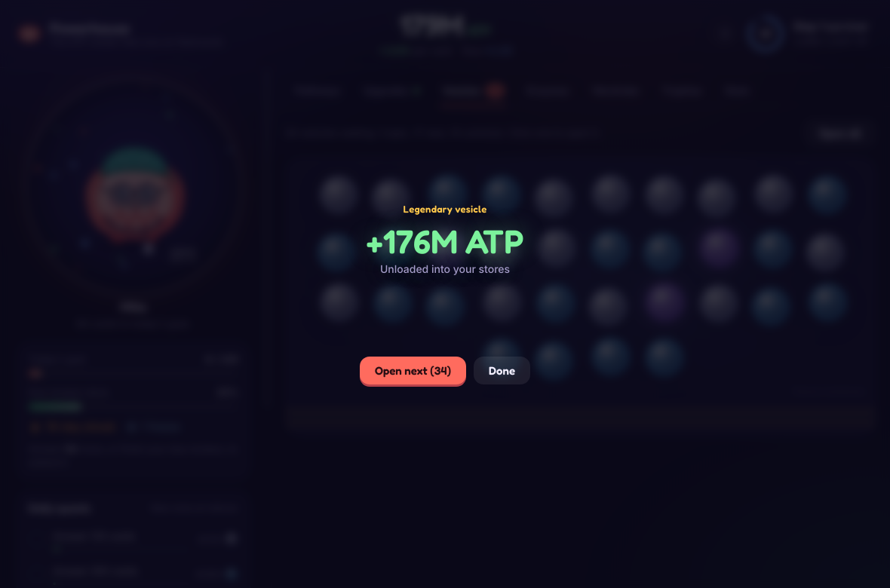
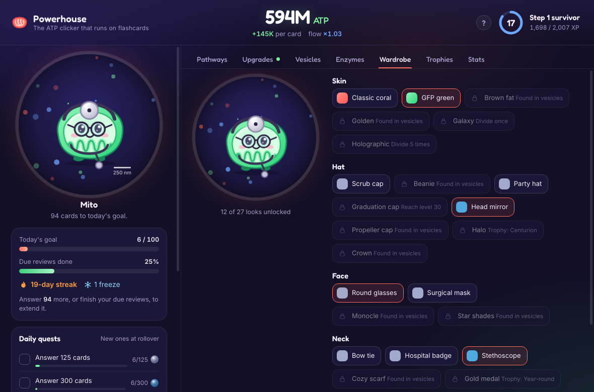
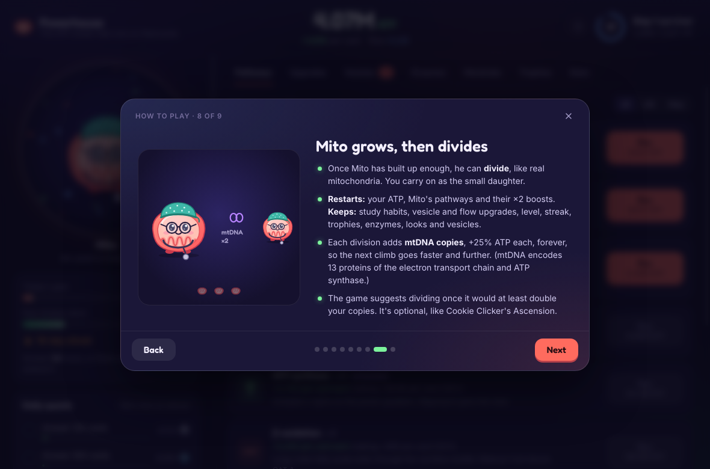

# Powerhouse

An ATP clicker that runs on your Anki reviews. Every card you answer makes ATP for
Mito the mitochondrion. Spend it on metabolic pathways that make every future card
worth more, open vesicles for collectible enzymes and outfits, and keep a daily streak.

New to it? The illustrated guide, [How-to-play.pdf](How-to-play.pdf), covers everything in ten pages.

## Install

In Anki (23.12 or newer, on a computer): **Tools → Add-ons → Get Add-ons…** and paste the
code from Powerhouse's AnkiWeb page (search for "Powerhouse" at ankiweb.net/shared/addons).
Restart Anki.

## Fair by design

- Again pays exactly what Easy pays: the button you press never changes what an answer earns.
- Speed never pays more. Flow only asks that you don't wander off for more than 3 minutes.
- Fair play: mashing through cards, looping one card, or letting auto-advance answer for you
  quickly stops earning anything. Reviewing at a normal pace is almost never affected.
- Powerhouse only reads your review log. It never changes cards, scheduling, decks or sync.
- Reviews from AnkiMobile, AnkiDroid or AnkiWeb count once they sync to your computer.

## Reporting a bug

Open an issue with what happened, your Anki version (Help → About) and, if you can,
the file `user_files/powerhouse.log` from the add-on's folder
(Tools → Add-ons → Powerhouse → View Files).

## For developers

- `addon/` is the add-on. `addon/README.md` explains how the pieces fit.
- `tests/` has the engine tests: `python -m pytest tests` (needs pytest only, not Anki).
- `tools/build.py` packages `addon/` as `dist/powerhouse.ankiaddon`.
- `tools/longsim.py` plays the real engine forward for months; `tools/pacing_report.py`
  runs it over several seeds and paces and prints when each milestone arrives.

## License

AGPL-3.0-or-later (see `LICENSE`). The Fredoka font is under the SIL Open Font License.
